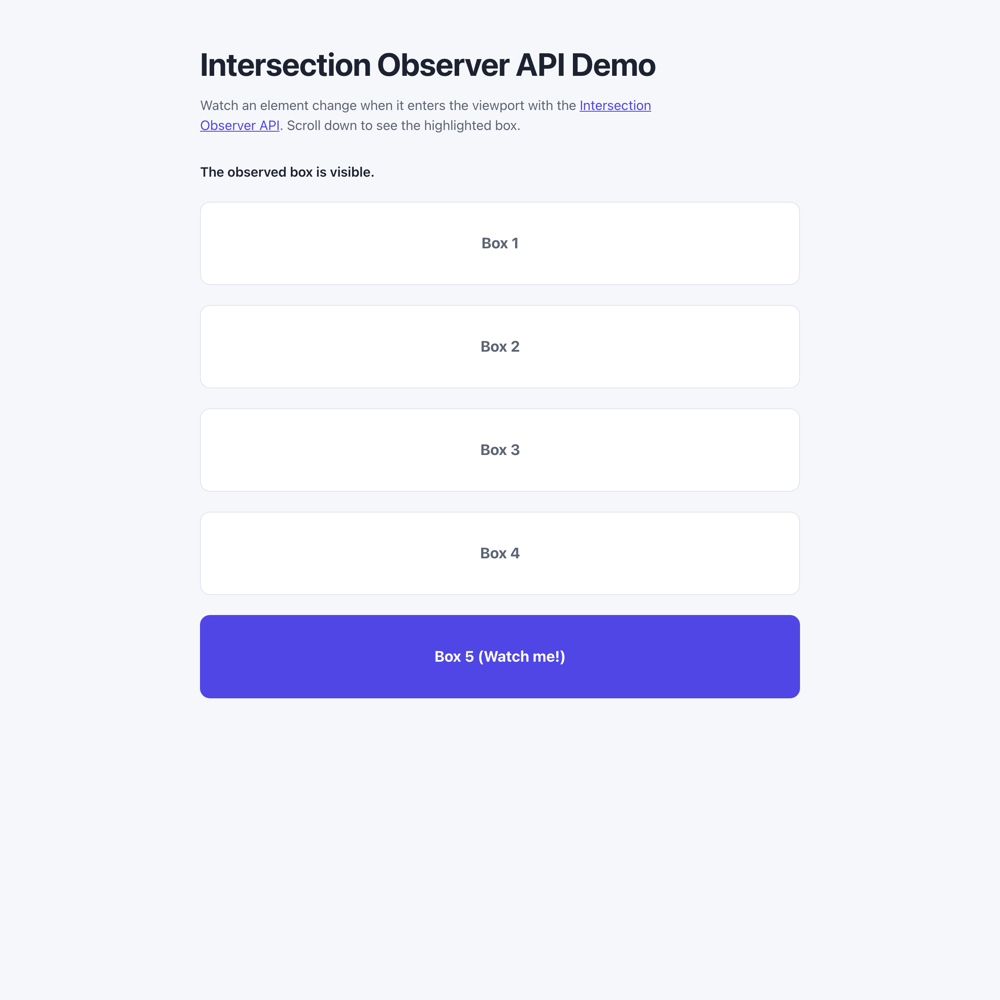

# WebSharper.IntersectionObserver

[](https://github.com/dotnet-websharper/IntersectionObserverAPI)

WebSharper bindings for the [Intersection Observer API](https://developer.mozilla.org/en-US/docs/Web/API/Intersection_Observer_API) —
observing element visibility within a viewport from F# and C# web apps.

This repository contains:

| Project | Purpose |
| --- | --- |
| `WebSharper.IntersectionObserver` | The binding: WIG definitions for `IntersectionObserver`, `IntersectionObserverEntry`, and `IntersectionObserverOptions`. |
| `WebSharper.IntersectionObserver.Sample` | An ASP.NET Core SPA that highlights a box when it scrolls into view. |

## Live demos

**Try it live:** [Open the sample in your browser](https://dotnet-websharper.github.io/IntersectionObserverAPI/)



The sample doubles as the binding's test case: it observes an element and toggles its CSS class as it enters and
leaves the viewport.

- **Sample (this repository):** <https://dotnet-websharper.github.io/IntersectionObserverAPI/>
- **Source repository:** <https://github.com/dotnet-websharper/IntersectionObserverAPI>
- **WebSharper bindings:** <https://websharper.com/bindings>

## Features

- `IntersectionObserver.observe()` / `unobserve()` / `disconnect()` / `takeRecords()`.
- `IntersectionObserverEntry` (`isIntersecting`, `intersectionRatio`, `target`, `time`, `boundingClientRect`, `intersectionRect`, `rootBounds`).
- `IntersectionObserverOptions` (`root`, `rootMargin`, `threshold` as a single number or an array).

## Installation

The binding is not currently published to NuGet. Reference the projects from source:

```bash
git clone https://github.com/dotnet-websharper/IntersectionObserverAPI.git
```

```xml
<ItemGroup>
  <ProjectReference Include="path/to/WebSharper.IntersectionObserver/WebSharper.IntersectionObserver.fsproj" />
</ItemGroup>
```

## Usage

```fsharp
namespace WebSharper.IntersectionObserver.Demo

open WebSharper
open WebSharper.JavaScript
open WebSharper.IntersectionObserver

[<JavaScript>]
module Demo =
    let observeElement () =
        let target = JS.Document.QuerySelector(".observer-box")

        let observer =
            new IntersectionObserver(
                (fun (entries: IntersectionObserverEntry array) ->
                    for entry in entries do
                        if entry.IsIntersecting then
                            entry.Target.ClassList.Add("visible")
                        else
                            entry.Target.ClassList.Remove("visible")
                ),
                IntersectionObserverOptions(Threshold = 0.5)
            )

        observer.Observe(target)
```

The callback receives an array of `IntersectionObserverEntry` values. `entry.IsIntersecting` is true when the
element crosses the configured threshold.

## Running the sample

Build the sample in Release and serve its static output:

```bash
dotnet build WebSharper.IntersectionObserver.Sample/WebSharper.IntersectionObserver.Sample.fsproj -c Release
python3 -m http.server -d WebSharper.IntersectionObserver.Sample/wwwroot 8099
```

Open <http://localhost:8099/> and scroll down. The last box turns the primary color when it enters the viewport.

Alternatively, run the ASP.NET Core host:

```bash
dotnet run --project WebSharper.IntersectionObserver.Sample
```

## Building from source

### Prerequisites

- [.NET SDK 10](https://dotnet.microsoft.com/download) or later.

### Build

```bash
dotnet build WebSharper.IntersectionObserver.sln -c Release
```

The binding projects target `netstandard2.0`; the sample targets `net10.0`.

## Deployment

Pushing to `main` triggers `.github/workflows/ghpages.yml`, which builds the sample in Release and publishes
`WebSharper.IntersectionObserver.Sample/wwwroot` to the `gh-pages` branch.

## Repository layout

```
WebSharper.IntersectionObserver/              # binding (WIG definitions)
  Main.fs
WebSharper.IntersectionObserver.Sample/       # ASP.NET Core SPA demo
  Client.fs
  Startup.fs
  wwwroot/
    index.html
    site.css
.github/workflows/ghpages.yml                 # build + deploy the sample to GitHub Pages
```

## Notes on the API

- **Performance:** Intersection Observer is optimized for performance and avoids polling the scroll position.
- **Threshold:** the threshold is the fraction of the element that must be visible before the callback fires. Pass
  a single number or an array of numbers.
- **Root:** `root` is the viewport by default. Pass a `Document` or `Element` to observe inside a scroll container.
- **Browser support:** Intersection Observer is Baseline and available in all modern browsers.

## License

Apache 2.0 — see [LICENSE.md](LICENSE.md).
